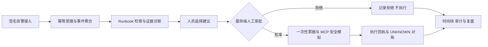
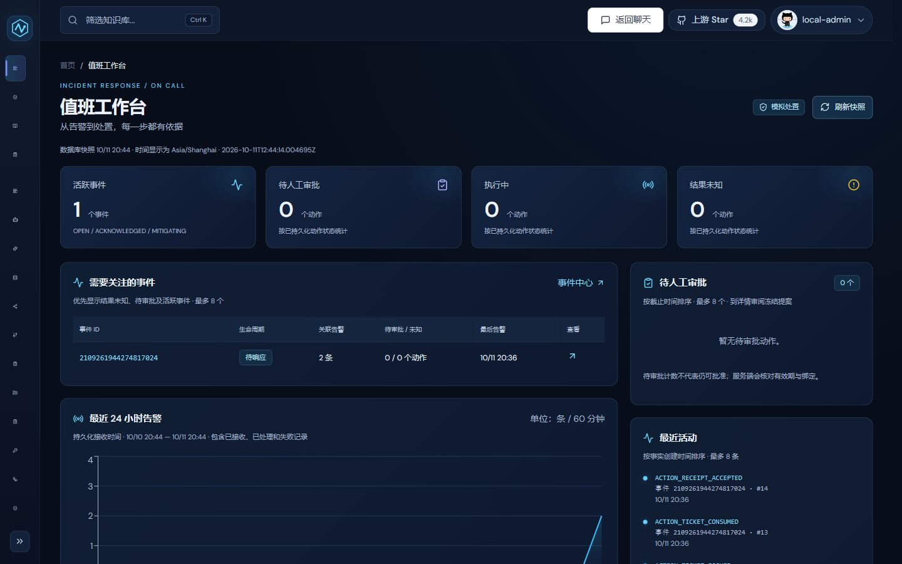
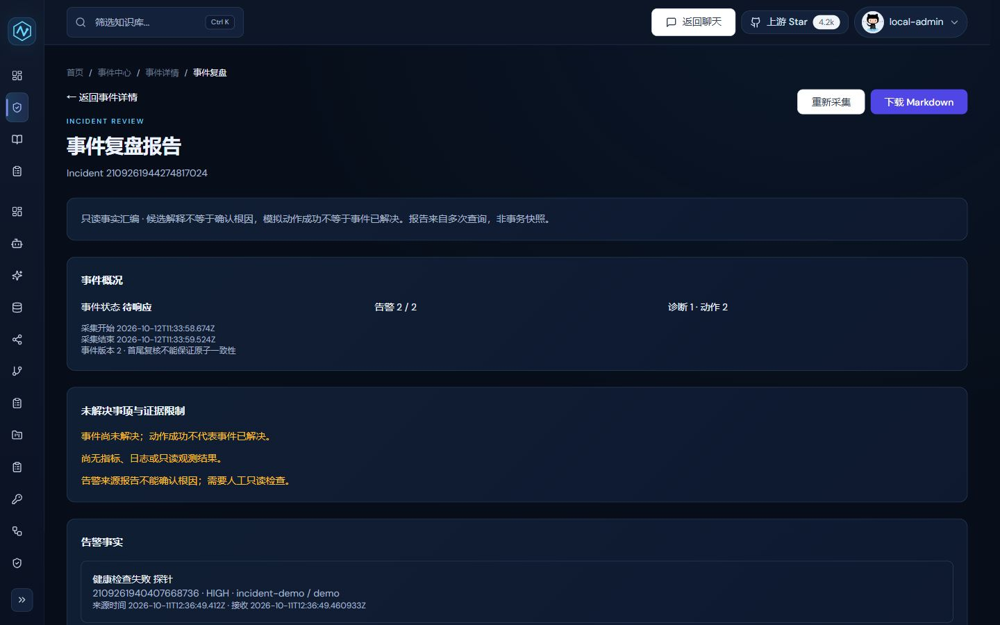

# IncidentPilot

**Java AI 运维事件响应平台：让告警、诊断、审批和处置形成可追溯的闭环。**

基于 [nageoffer/ragent](https://github.com/nageoffer/ragent) 改造，面向 SRE、运维人员和值班开发者。
项目重点是 Java 后端的可靠事件处理与安全执行；RAG、Agent 等通用能力复用上游，并明确区分新增贡献。

[快速启动](#快速启动) · [改造贡献](#改造贡献) · [核心设计](#核心设计) · [验证记录](#验证记录) · [架构文档](docs/ARCHITECTURE.md)

> 当前构建版本为 `0.1.0`，尚未创建正式 Release。默认演示使用本地模拟 Runbook 和安全模拟资源，不连接真实模型或生产处置系统。

## 项目解决什么问题

告警数量增加后，值班人员需要先判断哪些告警属于同一事件，再查阅处置手册、确认执行风险，并在交接时说明处理依据和结果。
IncidentPilot 将这些步骤组织为一条事件响应流程：



- **减少重复处理**：相同告警幂等受理，相关告警按规则聚合到 Incident。
- **保留诊断依据**：建议关联事实快照、Runbook 原文、行号和内容摘要。
- **约束处置风险**：人员批准、参数绑定与一次性票据由服务端执行，前端确认不能替代授权。
- **支持交接复盘**：事件状态、诊断、审批、回执和追加式时间线可以持续追溯。

## 界面预览

以下为 2026-10-11/12 本机持久安全演示的历史真实截图，仅作功能展示，不代表当前提交重新运行。
演示数据不代表生产事件或真实模型诊断；画面中的“上游 Star”属于原项目统计。

### 值班工作台



围绕待处理事件、风险状态和最近活动组织信息，从工作台进入事件详情与复盘。

### 事件复盘



只读汇总事件告警、诊断、动作和证据限制，支持值班交接与复盘，不在复盘页触发处置。

## 改造贡献

本项目是基于开源项目的二次开发，不将上游框架、界面或测试成果表述为自行从零实现。

| 范围 | 上游复用能力 | IncidentPilot 新增改造 |
| --- | --- | --- |
| 业务领域 | 用户、会话、知识库等基础功能 | 独立 `incident` 模块，告警接入、聚合、生命周期与运行状态 |
| 数据与一致性 | 数据访问、Redis/MQ 等基础设施 | 数据库幂等约束、追加式 Timeline、事务 Outbox、重试和恢复 |
| 诊断与证据 | RAG、Agent、模型路由、知识入库框架 | 本地模拟 Runbook 检索、事实快照、引用校验、诊断到 Action 的来源关联 |
| 安全执行 | MCP 协议桥接与通用工具框架 | 服务端审批、参数摘要绑定、一次性票据、模拟执行幂等、回执及 UNKNOWN 对账 |
| 用户界面 | 原有管理控制台与认证 | 值班工作台、事件详情、诊断审批、复盘报告和版本化处置手册 |
| 工程验证 | 原有单元与集成测试 | 故障实验、可靠性专项、确定性评测、统一门禁与本机持久演示工具 |

当前新增诊断采用确定性的 `lexical-v1` 检索与 `extractive-v1` 抽取，使用仓库内模拟语料，**不调用 LLM 或 Embedding**。
上游真实模型和 RAG 能力仍保留在源码中，但不属于本地安全演示的开放范围。

## 核心设计

| 关注点 | 实现方式 | 需要守住的业务不变量 |
| --- | --- | --- |
| 幂等受理 | `source + externalAlertId` 唯一约束与事务 | 相同身份不重复持久化；相同身份但载荷冲突时拒绝覆盖 |
| 聚合与状态 | 数据库锁、状态重检、版本校验 | 并发处理不静默覆盖状态，失败不留下部分关联事实 |
| 消息一致性 | Incident、Timeline 与 Outbox 在同一事务写入 | 发布失败保留同一事件身份，不能把未发送当作成功 |
| 人工审批 | 绑定工具与参数摘要，服务端发放一次性票据 | 未批准、过期、篡改或重放均不能绕过执行授权 |
| 模拟执行 | MCP 保护入口与执行幂等键 | 拒绝后零应用；批准后同执行身份只应用一次 |
| 不确定结果 | `UNKNOWN`、可信回执与对账 | 无法确认结果时不自动重试副作用，等待对账确认 |
| 诊断证据 | 冻结事实、校验引用位置和摘要 | 建议只能使用本次检索证据，证据不足时明确降级 |
| 审计追溯 | Timeline 只追加及数据库权限限制 | 历史事实不通过业务接口改写或删除 |

Incident 告警受理和聚合的正确性不依赖 Redis、Broker 或模型可用性。
本地演示关闭 Broker 发布，Outbox 可以保留为 `PENDING`，不会伪造消息发送成功。
详细调用链和边界见 [系统架构](docs/ARCHITECTURE.md) 与 [技术决策](docs/DECISIONS.md)。

## 技术栈与模块

后端使用 Java、Spring Boot、MyBatis-Plus、PostgreSQL、Redis 与 MCP Java SDK；前端使用 React、TypeScript 和 Vite。
仓库包含 **8 个 Maven 模块**，采用模块化主应用加独立 MCP 服务：

| 模块 | 职责 |
| --- | --- |
| `incident` | 告警、Incident、Timeline/Outbox、诊断事实、审批与执行记录 |
| `agent` | Agent 编排、MCP 适配及 Runbook 诊断编排 |
| `rag` | 知识库、入库、检索、Runbook 语料与评测 |
| `infra-ai` | Chat、Embedding、Rerank 等供应商适配 |
| `system` | 用户认证、用户上下文与系统审计 |
| `framework` | Web、数据库、Redis、MQ、幂等与追踪等公共能力 |
| `bootstrap` | 主应用装配与启动 |
| `mcp-server` | 独立 MCP 服务与受保护的安全模拟资源 |

`frontend/` 提供控制台；`resources/database/` 保存 Schema 与升级脚本；`specs/` 保存功能规格和实施记录。
Incident 主数据由 `incident` 模块管理，模拟资源在 MCP 独立数据库中，不混用数据所有权。

## 快速启动

推荐先运行**本机持久安全演示**，无需配置模型密钥。完整步骤与限制见 [本地运行说明](docs/development/local-demo.md)。

### 1. 准备环境与源码

参考实测组合：Windows、Java **21**、Node **20**/npm、PowerShell **7.6.5**、Docker Desktop 的 **Linux Engine** 和 Compose。
仓库提供 Maven Wrapper。POM 编译目标为 Java 17，但本地门禁运行要求 Java 21；Java 17、Node 22、Linux 宿主及托管 CI 尚未完成各自验收。

```powershell
$ErrorActionPreference = 'Stop'
git clone --branch release/v0.1.0 https://github.com/ovo11509-web/IncidentPilot.git
if ($LASTEXITCODE -ne 0) { throw 'CLONE_FAILED' }
Set-Location IncidentPilot
```

首次需要下载 Maven、npm 依赖及以下镜像；请先确认本机网络和 Docker 引擎可用：

```powershell
docker pull pgvector/pgvector:pg16
if ($LASTEXITCODE -ne 0) { throw 'PULL_MAIN_DB_FAILED' }
docker pull postgres:16-alpine
if ($LASTEXITCODE -ne 0) { throw 'PULL_SIMULATION_DB_FAILED' }
docker pull redis:latest
if ($LASTEXITCODE -ne 0) { throw 'PULL_REDIS_FAILED' }
docker pull rustfs/rustfs:1.0.0-alpha.72
if ($LASTEXITCODE -ne 0) { throw 'PULL_STORAGE_FAILED' }
```

`Init` 只使用本机已有镜像，不自动拉取。浮动标签可能变化，初始化会记录实际 image ID。

### 2. 初始化、构建与启动

在仓库根目录执行：

```powershell
pwsh -NoProfile -File scripts/local-demo.ps1 -Command Init
if ($LASTEXITCODE -ne 0) { throw 'INIT_FAILED' }
pwsh -NoProfile -File scripts/local-demo.ps1 -Command Build
if ($LASTEXITCODE -ne 0) { throw 'BUILD_FAILED' }
pwsh -NoProfile -File scripts/local-demo.ps1 -Command Start
if ($LASTEXITCODE -ne 0) { throw 'START_FAILED' }
pwsh -NoProfile -File scripts/local-demo.ps1 -Command Status
if ($LASTEXITCODE -ne 0) { throw 'STATUS_FAILED' }
```

`Build` 生成两个 executable JAR 和前端 production dist，**跳过测试，不等于验收通过**。
`Start`/`Status` 输出本实例的访问地址，端口动态分配并绑定 `127.0.0.1`。

### 3. 登录与浏览

- 账号：`local-admin`；随机密码由首次初始化生成。
- 仅在本机打开 `bootstrap/target/local-demo/default/credentials.json` 查看密码，勿上传该文件或把密码放入截图。
- 登录后进入“值班工作台”（`/admin/workbench`），从左侧“事件中心”（`/admin/incidents`）查看事件列表。
- 新实例可以是空工作台，`Init` 不会预置已处置事件。启动步骤以 [本地运行说明](docs/development/local-demo.md) 为准。
- [接手操作手册](specs/013-release-candidate/second-machine-handoff.md) 可作业务演练参考；其中 `070` 旧候选的固定包身份、文件数和哈希不适用于当前 Git clone，勿照搬旧包校验步骤。

本地演示只开放认证、Incident 和受保护的模拟 MCP；上游聊天、知识入库等接口在此模式下关闭。
处置只影响演示数据库内的 `demo` 目标，不用于操作真实服务。

### 4. 只读核验与停止

```powershell
pwsh -NoProfile -File scripts/local-demo.ps1 -Command Verify
if ($LASTEXITCODE -ne 0) { throw 'VERIFY_FAILED' }
pwsh -NoProfile -File scripts/local-demo.ps1 -Command Stop
if ($LASTEXITCODE -ne 0) { throw 'STOP_FAILED' }
```

`Verify` 只读核验，不提交告警、不批准或执行动作。`Stop` 停止本实例进程和容器，保留持久卷；再次 `Start` 可读取已有事件数据。
需要独立实例时，生命周期命令统一使用同一个 `-Name`；不要手改生成配置或删除既有卷。

## 验证记录

验收关注业务不变量，而不是用接口返回 200、代码行数或测试总数替代可靠性结论。

| 场景 | 检查内容 | 历史运行记录 |
| --- | --- | --- |
| 重复与并发告警 | 同身份唯一持久化、不同载荷冲突拒绝、固定聚合预期 | [Spec L 可靠性专项，2026-10-12](specs/012-incident-reliability-acceptance/implementation-report.md) |
| 完整处置与重启 | 两告警聚合一个事件；拒绝零应用、批准一次应用；重启后事实保留 | [固定 `070c4b76` 候选持久运行，2026-10-18](specs/013-release-candidate/persistent-candidate-runtime-report.md) |
| 测试与构建门禁 | Backend、依赖安装、Incident 页面检查、Lint 和 Build 同一次运行 | [`c1687735` 候选 / `d98d8861` All，2026-10-19](specs/013-release-candidate/cmd-dispatch-fix-report.md) |

这些结果分别归属报告中的源码候选、摘要和环境，不代表当前分支后续提交重新通过了相同测试。
本地模拟、受控故障和离线评测不等于生产 SLO、真实模型质量或跨平台验收；跳过的外部测试单独记录。

需要在自己环境验证时，先做前提检查，再运行实际门禁：

```powershell
pwsh -NoProfile -File scripts/check-delivery.ps1 -Gate All -CheckOnly
if ($LASTEXITCODE -ne 0) { throw 'ALL_PRECHECK_FAILED' }
pwsh -NoProfile -File scripts/check-delivery.ps1 -Gate All
if ($LASTEXITCODE -ne 0) { throw 'ALL_FAILED' }
```

`CheckOnly` 通过只表示前提检查完成。All 需要 Docker 和依赖缓存或下载网络，完整命令、退出码与报告范围见 [测试指南](docs/development/testing.md) 和 [交付门禁](docs/development/delivery.md)。

## 文档导航

- [项目上下文与贡献边界](docs/PROJECT_CONTEXT.md) · [系统架构](docs/ARCHITECTURE.md) · [技术决策](docs/DECISIONS.md)
- [本机运行与数据所有权](docs/development/local-demo.md) · [测试策略](docs/development/testing.md) · [交付门禁](docs/development/delivery.md)
- [功能规格与实施记录](specs/) · [可靠性专项](specs/012-incident-reliability-acceptance/spec.md)
- [版本与配置边界](docs/releases/configuration-boundary.md) · [源码候选说明](docs/releases/source-candidate-v0.1.0.md)

历史文档保留其执行时点，当前源码、配置和新的实际运行结果优先。尚未完成的异机、承诺平台、托管 CI 与生产验证继续保留为边界。

## 来源与许可证

IncidentPilot 衍生自 [nageoffer/ragent](https://github.com/nageoffer/ragent)，感谢上游作者的开源工作。
本分支保留作者、版权与上游署名，并使用经净化的衍生 Git 历史；历史内容净化会改变部分提交 SHA，不代表与上游最新分支同步。

代码遵循 [Apache License 2.0](LICENSE)，来源和修改范围见 [NOTICE](NOTICE)。通用 RAG/Agent 能力归属上游，本文列出的事件响应改造归属 IncidentPilot。
