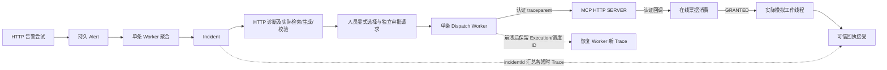

# OBS-001 实施与作者审阅

日期：2026-10-05。用户已确认 Spec E 并授权本地实施；本地安全模拟范围27/27任务完成，最终门禁及制品如下。

## 实际行为

- 每次 Incident HTTP 尝试由服务端分配 UUID，`Result.requestId`、`X-Request-Id` 和 `incident.observation` JSON 日志共用此值。调用方的 `X-Request-Id` 不参与分配。人员请求忽略外来 Trace；内部回调通过原服务认证后才提取单个有效 `traceparent`。
- 保留 Alert 首次 `correlationId`，聚合后以 `incidentId` 检索。`sourceRequestId`、人工结论正文 `requestId`、`dispatchRequestId` 继续承担既有业务语义。Schema、历史 Timeline、冻结诊断摘要、Outbox envelope 和 MCP `_meta` 七字段没有新增 Trace 字段。
- OTel 1.62.0 沿用已有 BOM。`observability.enabled` 默认关闭，关闭后仍有请求 UUID 和固定字段日志。开启时主应用只装配一个 SDK，独立 MCP 自持 SDK；原 Agent Trace 开关和内容策略由既有配置保留。
- 诊断的检索、生成和证据校验记录实际执行阶段，`REUSED` 不重复生成。审批等待、队列边界和重启不维持活跃 Span；恢复靠持久业务 ID，并生成新 Trace。
- MCP SDK transport 捕获不可变 Context，消费 `GRANTED` 后才加入可信业务 ID；timeout executor 在实际任务提交时显式传 Context/MDC。`incident.mcp.execute` 按工作线程实际结束关闭，取消请求不等于线程已经停止。
- 白名单共21个字段，Span属性预算24个，每值最多128个 ASCII 安全字符。内容、票据、凭据、参数、绑定摘要、目标、异常消息和堆栈不进入新增日志/Span。

## 真实代码调用路径

`IncidentRequestObservationFilter → AlertIngressFilter → AlertController → AlertReceiveService` 记录接入尝试及持久 Alert 身份；`AlertWorker → IncidentAggregationService` 记录实际 Alert→Incident 桥接。

诊断入口经 `IncidentDiagnosisOrchestrator → ExtractiveDiagnosisGenerator → DiagnosisEvidenceValidator → DiagnosisRecordService` 完成冻结事实、实际本地 Runbook 检索、抽取、复核及结果持久化；人员显式选择经 `DiagnosisActionSelectionService → ActionProposalService` 创建待审批 Action，审批经 `ActionDecisionService`。

`ActionDispatchWorker → IncidentRemediationDispatcher → /mcp/incident → ProtectedSimulationTool → IncidentCallbackClient → ActionTicketConsumptionService` 强制校验在线票据；获得 `GRANTED` 后由 `SimulationTimeoutEvaluator → SimulationToolExecutor` 在隔离模拟库应用一次。可信回执经 `ActionReceiptService` 接受；不确定结果继续沿原 `UNKNOWN`/对账/人工结论路径收敛。

重启由 `ActionDispatchRecoveryWorker` 保持原 Execution/调度身份并安全替票；`OutboxRelay` 每次发送产生新 Span，原 event/envelope 保持。

图中的持久队列、人员等待及恢复节点以业务身份连接；只有实际连续调用承诺Trace父子关系。

## 设计取舍

使用稳定业务身份连接短时 Trace，避免持久化 OTel 上下文和新增业务迁移。代价是跨重启没有 Span Link，崩溃前未导出的 Span 允许缺失，不能用缺失 Trace 推定执行结果。

主应用复用 framework，MCP 保持独立部署依赖，因此两个进程各有小型固定字段 scope，而没有增加跨模块运行依赖或可插拔观测平台。测试文件 exporter 只位于测试 classpath，替换同一个 SDK owner 采集实际 SpanData；生产配置的 SDK/出口行为由独立装配和本地503/阻塞/队列压力测试覆盖。

## 实际失败与修复

1. 子任务最初继承可信 MDC 字段，却未同步设置子 Span 属性。线程测试发现后在 scope 构造时安装继承属性，4项 MCP 线程/无效传播检查通过。
2. 测试文件 exporter 没有加入独立 MCP JVM 的测试 classpath，导致 ClassNotFound 和4项启动错误。仅修正测试启动 classpath 后采集到正常主链实际父子 Span。
3. 恢复夹具把已认证内部回调也按公开入口断言“不采用父 Trace”。修正为仅公开入口执行该断言；业务幂等、原票拒绝、补票和单次应用断言继续保留。最终重跑通过；恢复场景37个实际Span、两个主应用实例、新Trace及原Execution/调度ID、1次应用均已断言。

鉴权类导入和测试 ConfigurationProperties 装配问题另有失败日志。所有失败目录保留；失败运行不计为通过。

默认回归又发现旧人员网络夹具漏装 Spec D 的 IncidentQueryService，四项在启动时出错，已仅补齐测试 Bean。日志作者审阅还发现直接调用诊断保存服务时 identify 缺少scope门：诊断ID会残留到后续操作MDC。两进程辅助工具增加OTel ContextKey标记，只允许活跃观测scope填身份；新增“scope外无残留、下一操作无旧身份”行为断言。修复后最小19项回归与完整默认门禁均通过。另增加真实PostgreSQL聚合在SpanExporter返回失败时仍保持业务/历史/幂等的检查，避免仅以循环计数说明业务安全。

## 验证与证据

本轮汇总目录为 `bootstrap/target/obs-evaluation/354648e4-9f73-45ca-ba0a-bd23eae2fd00/`。环境为本机 JDK21.0.12+8、release17、Docker Desktop29.4.3、Testcontainers2.0.5，动态端口和临时 PostgreSQL/Redis/存储、独立 Bootstrap/MCP JVM。本次没有连接开发数据库或付费模型。

定向业务检查32项通过；追加定向检查51项通过但当轮 Bootstrap 启动失败。修正后双 JVM 4项中3通过/1测试断言失败，黄金主链68个Span、诊断安全56个Span、回执故障88个Span形成实际断言制品。最新默认 Java 门禁840项，0失败/错误，21跳过，退出0；结束于2026-10-05T12:49:20+08:00。四个OBS双JVM场景全部通过，最终成功目录、实际秘密扫描及manifest/hash见[quickstart](quickstart.md#最终本轮结果)。本轮1752个原有文件均在，54个有意编辑、1698个字节不变；新增16个源代码/测试/报告文件。分支/HEAD/空暂存区保持，git diff --check通过；清单标记保持只读，前后hooks不存在。

未验证 OTLP 后端接收/存储、生产或跨主机、性能、真实模型、真实工具、真实 Broker；本轮没有前端改动或浏览器验收。固定发布器验证 Relay 重投，不宣称 Broker 验收。

## 作者自检

1. 两个 Alert 的 correlationId 不同，但已经聚合为同一 Incident，排错时应使用哪个 ID 汇总？HTTP UUID 又对应哪个边界？
2. `Future.cancel(true)` 返回后，为什么 execute Span 仍可能没有结束？此时业务结果为何可能是 UNKNOWN？
3. Worker 重启后的新 Trace 为什么不能被当作新逻辑执行？哪些稳定 ID 和数据库事实证明模拟只应用一次？

实施贡献属于 IncidentPilot 新增主链观测；上游 RAG/Agent Trace、AgentScope、MCP 基础及 Apache-2.0 署名与 Git 历史保留。
