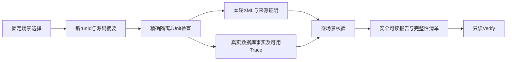

# LAB-001 实施与作者审阅

日期：2026-10-05。用户批准Spec F，18/18任务完成；结果以实际manifest与本文件记录为准，未以历史840项Java门禁替代本轮实验。

## 实际调用路径

`run-lab.ps1 → Invoke-Lab → 固定scenarios.json → 本轮runId/源码摘要/运行锁 → Maven LAB-only报告profile → 精确JUnit类/方法 → 临时资源与既有故障 → proof-origin/XML/事实/SpanData → Test-LabScene → result/manifest/report/SHA256SUMS`。

`-Verify → Test-LabArchive → 安全路径和文件集合 → 摘要 → 固定目录/manifest结果一致性 → XML来源/精确测试 → 事实与Trace语义复核`。该路径不启动Maven、Docker或处置服务。

Java扩展只在测试代码中：AlertRecoveryTest/OutboxRecoveryTest通过既有EvidenceManifestWriter导出计数与身份；Bootstrap夹具按LAB输出根保存原始证明及逐Execution实际应用数；OBS检查仍验证父子、稳定身份和线程语义，新来源证明加入实际秘密扫描。没有新业务表或生产协议。

## 设计取舍

固定目录和串行仓库锁复用已有故障，不新增故障插件或调度服务。实验重放表示重新执行固定安全实验，不是向开发数据库重放历史告警，更不是对UNKNOWN再次写操作。

根pom仅新增lab.reportRoot激活的Surefire报告profile，因为插件metadata没有reportsDirectory的CLI property；普通测试位置和生产配置保持。source-hashes记录未提交源码的实际内容，不能只以HEAD说明版本。

SHA256用于发现缺失与变化，不是数字签名，不能声称抵御恶意者同时改写全部证据。Verifier同时检查来源、固定目录、精确XML与关键事实，拒绝未完成、失败和跳过；Trace缺失不能代替业务判断。

## 真实失败与修复

- 首次告警实验两项数据库检查通过，但辅助类把证明写在场景根目录而非proof子目录，归档拒绝；统一路径后复跑通过。原3fb8daa3-af1c-4ae0-b173-a4ec7c394a14保留FAIL。
- Windows PowerShell 5.1的JSON数组管道返回与7不同，目录计数失败；显式返回JSON值并使用UTF-8脚本后，两版本契约检查通过。
- 首次Worker实际双JVM检查通过，但Verifier误要求崩溃前后各一个MCP dispatch Span；崩溃发生在实际MCP调用前，应检查action.dispatch/recover阶段的新Trace与原业务ID。修正后b160c2a1-3e78-4a65-bf90-79b9ba14fcb6通过，原f72da437-a00d-4735-9dc6-c456ba06ab43归档FAIL保留。

## 已有阶段结果

| 场景 | 通过runId | 目标检查数 | 实际Span | 实际秘密扫描 | 应用 |
| --- | --- | --- | --- | --- | --- |
| ALERT-REPLAY | a8ef9242-06a1-4fb6-ba2a-71ff72c849f9 | 2 | 未承诺 | 不导出凭据 | 不适用 |
| OUTBOX-RETRY | ac55ec66-bb45-44b2-b290-71127033ff31 | 1 | 未承诺 | 不导出凭据 | 无MCP |
| WORKER-RECOVERY | b160c2a1-3e78-4a65-bf90-79b9ba14fcb6 | 1 | 37 | 7，零命中 | 1 |
| RECEIPT-CHANNELS | 5d8b0e61-8cf7-4cd5-933a-37cc0fe98fd1 | 1 | 88 | 7，零命中 | 三执行各1 |
| GOLDEN | eb2297a0-b0f1-4250-bdc0-075242200a0b | 1 | 68 | 6，零命中 | 1 |
| DIAGNOSIS-SAFETY | 39270b70-12ea-44a7-9374-92ceb365ab65 | 1 | 56 | 5，零命中 | 0 |

目录均为bootstrap/target/fault-lab/对应runId。上述目标检查无失败/错误/跳过，成功归档及只读核验已有记录；六类独立运行已通过；统一All及实际归档负例均已通过。脚本fixture的BLOCKED证明明确标为SCRIPT_CONTRACT_FIXTURE，不是Docker真实故障或Java运行证据。

## 最终验收

统一All：2fba02a7-4681-409b-9030-10212de0b51f，六场景7项、零失败/错误/跳过、退出0；249实际Span，25个实际秘密扫描零命中，1155源码及107制品摘要，Verify通过。三个回执execution分别核对一次应用；黄金路径一次，诊断拒绝零次。

PowerShell 7与Windows PowerShell 5.1分别30项契约检查通过，含真实归档副本负例与只读原件核验。首次检查虽30项通过，模拟Docker留下全局LASTEXITCODE=1；修复恢复该全局值及显式脚本退出后两版本重跑均退出0。fixture明确标记SCRIPT_CONTRACT_FIXTURE，不能充作真实服务故障。

统一归档保留当时源码。之后仅test-run-lab.ps1退出码修复，运行入口/目录/Java/POM未改；不声称统一运行与最终整个源码快照完全相同。最终轻量复跑9a2619ae-5b12-4249-a45d-26e21adc1b1f两项通过、Verify通过，新目录保留前轮。默认LAB profile关闭的5项兼容性回归通过，零失败/错误/跳过，默认报告路径及OBS证明正常。完整实际命令和结果见 [复现指南](quickstart.md)。

原有1771文件基线逐项核对；仅本功能已列出的测试、POM、Spec及长期上下文文档发生预期修改，无丢失。分支feature/incident-platform、HEAD 67624931f20812922568d3641a095adb291263ba保持，暂存为空；相对引用、任务唯一性及git diff --check核对通过。审批checklist未代签。

## 作者自检

1. 为什么Maven的BUILD SUCCESS仍可能得到LAB FAIL？哪些来源、证明或事实缺失必须拒绝通过？
2. Worker重启后的新Trace为什么不是新逻辑执行？恢复前后哪些数据库身份与应用次数支持判断？
3. Outbox七次发送尝试、两个事件最终PUBLISHED能证明什么？为什么仍不能声称真实Broker/消费者的端到端exactly-once？

本功能是IncidentPilot新增的本地实验入口与证据核验；上游Ragent、Maven/Agent/MCP等基础及Apache-2.0署名保留。无提交、推送、合并、部署、付费调用、开发库或真实基础设施操作；未验证生产、性能、跨主机、真实模型/工具/Broker或OTLP存储。
