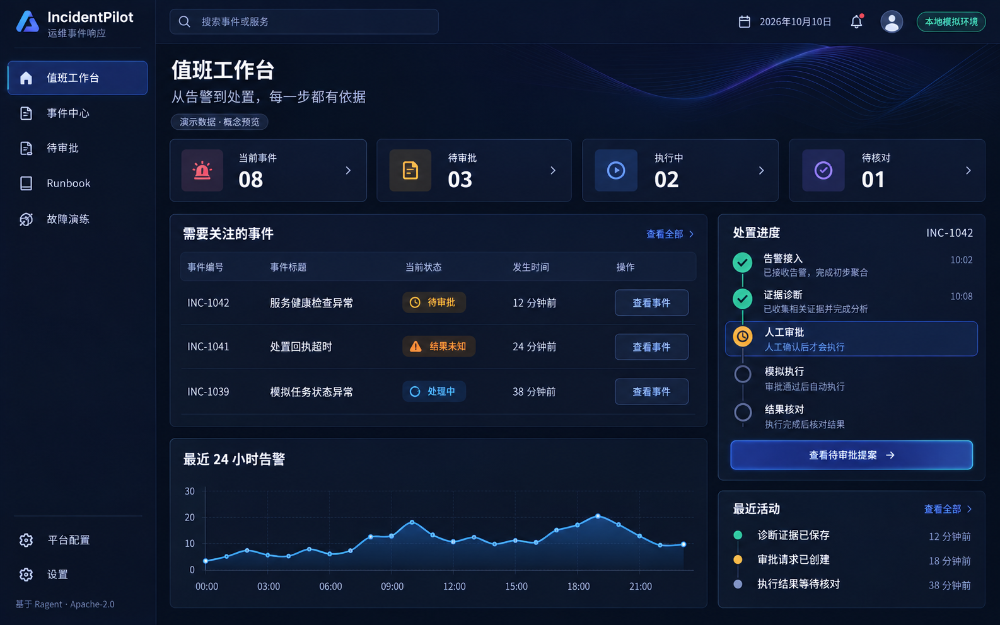

# 功能规格：IncidentPilot B 风格值班工作台

**功能分支**：`feature/incident-platform`（沿用现有分支，不创建或切换分支）

**创建日期**：2026-10-10

**状态**：2026-10-12，已批准本地范围29/29完成，规定四视口截图、原生滚轮、角色及旧配置视觉复核已补齐。具体证据与未验证边界见 [实施记录](implementation-report.md)。

**输入**：用户希望衍生项目具备自己的产品体验，比较专业运维控制台与 AI 科技工作台后选择第二个 B 预览。

## 用户场景与测试（必填）

### 用户故事 1 - 识别 IncidentPilot 并进入值班工作台（优先级：P1）

管理员进入后台后看到 IncidentPilot 品牌、深色背景、蓝紫强调色和围绕事件响应组织的导航；能进入值班首页、事件中心和现有平台配置。普通用户的聊天入口保持可用。页面提供真实上游归属说明。

**优先级理由**：首先改变产品入口与主视角，使新增运维能力成为主体。

**独立测试**：以管理员和普通用户分别登录，验证默认入口、导航、退出与权限；在不同窗口高度下滚动、折叠和展开侧栏。

**验收场景**：

1. **Given** 管理员已登录，**When** 进入后台默认入口，**Then** 显示 B 风格值班工作台，品牌为 IncidentPilot，现有配置页面仍可从导航访问。
2. **Given** 普通用户已登录，**When** 尝试进入值班工作台，**Then** 不获得管理员事件数据，仍可使用原有聊天功能。
3. **Given** 导航内容高于窗口，**When** 使用滚轮或键盘导航并折叠、展开侧栏，**Then** 所有实际导航项均可到达，品牌区与底部操作保持可用。

### 用户故事 2 - 根据真实事件数据安排下一步处理（优先级：P1）

管理员在首页查看活动事件、待审批提案、执行中动作和结果未知动作的数量，最近 24 小时告警趋势、近期事件和最近事实；能打开相应事件详情及待审批提案。

**优先级理由**：让首页直接服务值班处理，避免概念图数字变成无法验证的展示数据。

**独立测试**：在隔离环境写入已知事件、动作、告警和时间线事实，核对各项计数、趋势和链接。分别检查空库、请求失败与未授权访问。

**验收场景**：

1. **Given** 已知数量及状态的业务记录，**When** 刷新首页，**Then** 所有卡片与趋势准确匹配同一查询时点的数据；显示口径及更新时间。
2. **Given** 同一告警被重复提交，**When** 查询告警趋势，**Then** 只按实际保存的一条告警计数，来源上报时间不改变接收窗口口径。
3. **Given** 首页读取失败，**When** 页面展示状态，**Then** 明确显示不可用或旧数据及其时间，不能把失败显示为零，也不能用示例数字代替。
4. **Given** 首页包含待审批提案或 UNKNOWN 动作，**When** 打开详情，**Then** 进入相应事件的已有审批/执行证据区域；首页本身不会批准或执行动作。

### 用户故事 3 - 在统一主题中复核诊断、审批与结果（优先级：P1）

管理员从事件中心进入详情，在 B 风格页面读取来源事实、诊断引用、冻结提案、执行回执和只追加时间线。页面清楚区分事件生命周期与动作状态，不用装饰性的流程图推断事实。

**优先级理由**：首页、事件列表与详情形成同一产品体验，同时保留既有安全交互。

**独立测试**：完成关联告警读取、诊断、创建提案、拒绝/批准与结果核对；验证 UNKNOWN、过期或失效建议、长标识符及证据文本的表现。

**验收场景**：

1. **Given** 事件有多次诊断与多个动作，**When** 查看流程摘要，**Then** 摘要明确关联当前所选诊断/动作，不把历史成功或任一诊断自动视为当前事件完成。
2. **Given** 动作结果为 UNKNOWN，**When** 查看详情，**Then** 显示“结果未知”及核对提示，不显示成功、不提供未经既有协议授权的写重试。
3. **Given** 建议已失效、参数预览不可用或审批条件不满足，**When** 用户尝试操作，**Then** 原有禁用、校验、版本冲突和错误提示继续有效。

### 边界情况

- 空数据库、暂无诊断/动作、统计请求失败、登录过期、无管理员权限。
- 查询期间 Worker 改变状态；卡片、事件与活动必须来自一致的数据快照。
- 多条告警、多次诊断、多次提案及历史 UNKNOWN 与当前事件生命周期不同步。
- 超长标识符、标题或引用；所有事件标识符完整保留，可换行或复制，不截断后误导航。
- 小窗口、窄屏、侧栏折叠、键盘焦点和减少动态效果设置。
- 其他平台配置页面仍有自己的浅色内容区；公共外壳主题不得破坏其表格、弹窗或滚动。

## 需求（必填）

### 功能需求

- **FR-001**：系统 MUST 采用用户选择的 B 方向：深色海军蓝背景、分层面板、克制的青蓝/紫色强调；状态与错误文字在深色背景上可辨认，发光与装饰不得妨碍信息读取。
- **FR-002**：系统 MUST 将后台品牌显示为 IncidentPilot，并提供 `nageoffer/ragent` 与 Apache-2.0 的真实归属；保留既有许可证、历史、源码声明和功能。
- **FR-003**：系统 MUST 为管理员提供默认值班入口、事件中心和实际可用的平台配置导航；本阶段不得添加没有实现内容的 Runbook 管理或故障演练入口。
- **FR-004**：系统 MUST 从权威持久化记录汇总活动事件数（OPEN、ACKNOWLEDGED、MITIGATING）、待审批提案数（PENDING_APPROVAL）、执行中动作数（EXECUTING）及结果未知动作数（UNKNOWN）；后面三项的单位为动作，不得与事件数混淆。待审批状态数量不保证每条提案仍可被批准。
- **FR-005**：系统 MUST 返回统计生成时间，并让同次首页数据来自一致快照。不得将已读取的第一页记录数冒充总数。
- **FR-006**：系统 MUST 根据服务端接收时间统计过去 24 小时持久化告警，提供连续 24 个一小时区间与明确起止时间；没有告警的区间为零，重复接收不重复计数。
- **FR-007**：系统 MUST 提供最多 8 条关注事件（活动事件或仍有待审批/UNKNOWN 动作的事件）、最多 8 条待审批提案和最多 8 条最近时间线事实；稳定排序，并提供到既有事件详情的可操作链接。完整历史继续通过事件中心/详情查看。
- **FR-008**：系统 MUST 只在管理员身份校验通过后提供首页事实；返回信息不得包含告警原始载荷、票据、签名、认证凭据、内部执行证明或未审查的任意摘要。
- **FR-009**：系统 MUST 分别呈现加载、确认为空、错误及更新时间。失败时不得展示假零、随机数据或概念图数字；刷新使用只读方式。
- **FR-010**：系统 MUST 统一事件列表、详情、诊断、审批和时间线的 B 风格，并保留原有分页、刷新、轮询停止条件和来源证据读取。
- **FR-011**：系统 MUST 将事件生命周期、审批状态、执行状态分别标注；流程摘要只能来自明确关联的记录，缺失信息显示缺失/未知，不能把诊断候选当作确认根因。
- **FR-012**：系统 MUST 保持既有服务端审批、冻结绑定、一次性票据、幂等执行、UNKNOWN 核对及只追加审计规则。执行成功不会自动表示 Incident 已解决。
- **FR-013**：系统 MUST 提供可见键盘焦点和文字状态说明；正文正常文字对比度至少 4.5:1，大字号及控件边界至少 3:1，不仅依赖颜色表达状态。
- **FR-014**：系统 MUST 在 1440×900、1280×720、768×1024 和 390×844 视口保持可操作；宽表可局部横滚，侧栏可滚动，正文不被全局横向溢出遮挡。
- **FR-015**：系统 MUST 明示当前处置范围为模拟资源；不得把模拟范围包装为真实生产处置或真实模型诊断质量。
- **FR-016**：系统 MUST 用隔离业务事实、鉴权检查和实际浏览器操作验证新增查询与主流程；静态截图或构建通过不能代替事实一致性和交互验收。

### 关键实体（功能涉及数据时填写）

- **首页快照**：生成时点、24 小时窗口、四项统计、固定窗口趋势和有界记录列表；是只读视图，不拥有业务状态。
- **近期事件**：事件标识、生命周期、告警数、版本与时间；不增加新的事件事实或主表。
- **待审批提案摘要**：动作标识、事件标识、持久化状态和审批截止时间；完整参数和审批操作由既有详情负责。
- **最近活动摘要**：事件/事实标识、序号、类型及时间；完整安全摘要仍在事件详情中读取。
- **视觉基准**：B 概念图及主题规范，展示数字与文案不属于真实业务记录。

## 成功标准（必填）

### 可度量结果

- **SC-001**：品牌、后台默认入口、公共导航、值班首页与现有事件四类页面符合 B 方向；上游归属可访问，旧配置入口无失效链接。
- **SC-002**：已知业务集合、空集合、边界时间、重复告警和多动作场景中，四项计数与 24 个告警区间全部符合约定；与权威记录核对零差异。
- **SC-003**：未登录和非管理员两类身份均不能读取首页事实；返回及日志抽查不含禁止暴露的字段。
- **SC-004**：四个规定视口下，导航滚动/折叠、事件分页、详情、证据展开和审批操作均可完成；正文没有遮挡核心操作的横向溢出。
- **SC-005**：主流程依次完成诊断、提案、拒绝零应用、批准一次模拟应用；UNKNOWN 仍明确未知且无新增写重试。
- **SC-006**：页面加载、空、错误与刷新状态均经过实际验证；任何场景均不将概念数据当作运行数据。
- **SC-007**：新增及受影响自动检查、前端生产构建和浏览器核对具有本轮记录，未执行项单独列明，不复用历史通过结论作为本轮验收。

## 假设

- 用户选定的是 B 视觉方向；首阶段技术范围及任务待审阅，并非已经批准后端实现、提交或部署。
- 本阶段只覆盖公共外壳、值班首页及既有事件页面；登录/聊天重设计、全部配置页换肤、Runbook 编辑与故障演练 GUI 不包含在内。
- 现有管理员数据范围为全局管理员范围；本阶段不增加多租户、生产权限或外部系统接入。
- 保留当前认证、现有数据库和主链；查询不得新增业务副作用或数据清理。
- 先采用静态装饰与已安装依赖，不引入新动画框架或付费资源。
- 常驻 Compose、干净 Linux/Node22 复现、托管 CI 与正式版本发布仍是后续交付工作，不由此次视觉选择自动获得授权。

## 视觉参考

参考图用于色彩、层级与空间关系；正式页面依据真实接口及上述口径调整。图中的假编号、数量、流程事实、Runbook/演练菜单和搜索文案不直接照搬。
